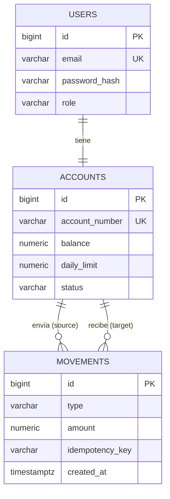

# Mollet 💸 — API de billetera digital

[](https://github.com/jhamile4/mollet/actions/workflows/ci.yml)


API REST de una billetera digital en soles (al estilo de las apps de pagos entre personas): registro de usuarios, cuenta
con saldo, recargas, **transferencias seguras entre cuentas**, historial paginado y panel de administración.

> 🌐 **Demo en vivo:** _pendiente de despliegue_ · [Swagger UI](#) · [Health check](#)
>
> El plan gratuito "duerme" el servicio tras 15 minutos sin uso: la primera petición puede tardar ~1 minuto.

---

## ¿Qué problema resuelve?

Mover dinero parece un simple `saldo = saldo - monto`, pero en producción aparecen problemas reales:

| Problema | Qué pasaría sin cuidarlo | Cómo lo resuelve Mollet |
|---|---|---|
| **Dos transferencias al mismo tiempo** desde la misma cuenta | Ambas leen "saldo S/ 100", ambas pasan y el saldo queda negativo | Bloqueo pesimista de la fila (`SELECT … FOR UPDATE`) dentro de una transacción |
| **Reintentos** (la app no recibió respuesta por un corte de red y vuelve a enviar) | Se cobra dos veces | Header `Idempotency-Key`: la misma clave devuelve la transferencia original |
| **Transferencias cruzadas** A→B y B→A simultáneas | *Deadlock* en la base de datos | Las cuentas se bloquean siempre en el mismo orden (id menor primero) |
| **Fraude / errores** | Vaciar una cuenta en minutos | Límite diario de envío (S/ 500, calculado con el día de **Lima**, no UTC) |
| **Errores de redondeo** | `0.1 + 0.2 = 0.30000000000000004` | `BigDecimal` en Java y `NUMERIC(19,2)` en PostgreSQL |
| **Bugs futuros** | Un error de código guarda un saldo negativo | `CHECK (balance >= 0)` en la base de datos como segunda barrera |

Todo esto está cubierto por pruebas automáticas, incluida una que lanza **10 transferencias en paralelo** contra
PostgreSQL real y comprueba que pasen exactamente las que alcanza el saldo.

## Stack

- **Java 21** · **Spring Boot 3.5** (Web, Data JPA, Validation, Security, Actuator)
- **PostgreSQL 17** con migraciones **Flyway**
- **Spring Security + OAuth2 Resource Server**: JWT firmado (HS256), roles `USER` y `ADMIN`
- **MapStruct** para mapear entidades a DTOs · **springdoc-openapi** (Swagger UI)
- **JUnit 5 + Mockito** (unitarias) · **Testcontainers** (integración con PostgreSQL real)
- **Docker** multi-stage · **docker-compose** · **GitHub Actions** · desplegado en **Render + Neon**

## Arquitectura

Organización **por funcionalidad** (no por tipo de clase), con capas dentro de cada módulo:

```
src/main/java/com/mollet
├── auth/        registro, login y emisión de JWT
├── account/     cuenta, saldo, recargas, historial y administración
├── movement/    transferencias (la lógica crítica) y movimientos
├── user/        usuarios y roles
├── config/      seguridad, OpenAPI, propiedades, admin inicial
└── common/      manejo global de errores y paginación
```

```mermaid
flowchart LR
    C[Cliente / Swagger] -->|HTTPS + Bearer JWT| F[Spring Security<br/>valida token y rol]
    F --> CT[Controller<br/>valida DTO]
    CT --> S[Service<br/>@Transactional + reglas]
    S --> R[Repository<br/>Spring Data JPA]
    R --> DB[(PostgreSQL<br/>Flyway)]
    S -. lanza .-> E[BusinessException]
    E --> H[GlobalExceptionHandler<br/>ProblemDetail JSON]
```

### Modelo de datos



Los movimientos son **inmutables** (como un libro contable): nunca se editan ni se borran.

### Flujo de una transferencia

1. Buscar el **id** de la cuenta origen (desde el token) y de la destino (por número de cuenta).
2. Bloquear ambas filas con `SELECT … FOR UPDATE`, **siempre en orden de id** (evita deadlocks).
3. Si ya existe un movimiento con esa `Idempotency-Key` → devolverlo (200) sin volver a cobrar.
4. Validar: cuentas activas, límite diario y saldo suficiente.
5. Debitar, acreditar y guardar el movimiento. Todo en **una transacción**: si algo falla, no se mueve nada.

## Endpoints principales

Base: `/api/v1` · Documentación interactiva en `/swagger-ui.html`

| Método | Ruta | Rol | Descripción |
|---|---|---|---|
| POST | `/auth/register` | público | Registra usuario + cuenta y devuelve JWT |
| POST | `/auth/login` | público | Devuelve JWT |
| GET | `/accounts/me` | USER | Mi cuenta y saldo |
| POST | `/accounts/me/deposits` | USER | Recarga simulada (máx. S/ 5 000) |
| GET | `/accounts/me/movements?page=0&size=20` | USER | Historial paginado (IN/OUT) |
| POST | `/transfers` + header `Idempotency-Key` | USER | Transferir a otra cuenta (201; 200 si es reintento) |
| GET | `/admin/accounts?status=ACTIVE` | ADMIN | Listar cuentas paginadas |
| PATCH | `/admin/accounts/{numero}/status` | ADMIN | Bloquear / desbloquear cuenta |
| GET | `/actuator/health` | público | Estado de la app y la base de datos |

### Formato de errores (igual para todos)

Basado en el estándar **RFC 9457 (Problem Details)**, con un `code` estable para el frontend:

```json
{
  "type": "about:blank",
  "title": "Saldo insuficiente",
  "status": 422,
  "detail": "Saldo insuficiente: tienes S/ 10.00 y quieres enviar S/ 10.01",
  "instance": "/api/v1/transfers",
  "code": "INSUFFICIENT_FUNDS",
  "timestamp": "2026-11-23T15:40:20Z"
}
```

Códigos: `VALIDATION_ERROR` (400, con lista `errors` por campo), `UNAUTHORIZED` (401), `FORBIDDEN` (403),
`ACCOUNT_NOT_FOUND` (404), `EMAIL_ALREADY_REGISTERED` / `IDEMPOTENCY_KEY_REUSED` (409),
`INSUFFICIENT_FUNDS` / `DAILY_LIMIT_EXCEEDED` / `ACCOUNT_BLOCKED` / `SAME_ACCOUNT_TRANSFER` (422).

## Cómo ejecutarlo

Requisitos: **Java 21+** y **Docker**. No necesitas instalar Maven (el proyecto trae `mvnw`).

**Opción A — Todo con Docker** (API + base de datos):

```bash
docker compose --profile app up --build
# http://localhost:8080  → redirige a Swagger
```

**Opción B — Base de datos en Docker y API desde el IDE / terminal** (perfil `dev`):

```bash
docker compose up -d db
./mvnw spring-boot:run        # en Windows PowerShell: .\mvnw spring-boot:run
```

Admin local: `admin@mollet.dev` / `Admin12345` (solo en desarrollo; en producción se define por variables de entorno).

### Probarlo en 1 minuto (Swagger)

1. `POST /api/v1/auth/register` con dos usuarios distintos → copia el `accessToken` del primero.
2. Botón **Authorize** → pega el token.
3. `POST /api/v1/accounts/me/deposits` con `{"amount": "200.00"}`.
4. `POST /api/v1/transfers` con el número de cuenta del segundo usuario y cualquier `Idempotency-Key`.
5. Repite la misma petición con la misma clave: verás `200` y `Idempotent-Replayed: true`, sin doble cobro.

## Pruebas

```bash
./mvnw test      # 17 pruebas unitarias (JUnit 5 + Mockito), sin Docker, en segundos
./mvnw verify    # + 21 pruebas de integración con PostgreSQL real (Testcontainers, requiere Docker)
```

| Tipo | Qué cubre |
|---|---|
| Unitarias (`*Test`) | Reglas de `Account` y `TransferService`: saldo, límite diario (zona Lima), idempotencia, orden de bloqueo, cuentas bloqueadas; registro y login |
| Integración (`*IT`) | Flujo HTTP completo con JWT, validaciones, formato de errores, 401/403, paginación, admin, **concurrencia** y **deadlocks** |

CI en GitHub Actions ejecuta `./mvnw verify` y construye la imagen Docker en cada push.

## Configuración y perfiles

| Perfil | Uso | Base de datos y secretos |
|---|---|---|
| `dev` (por defecto) | Tu máquina | `docker-compose` con valores locales |
| `test` | Pruebas de integración | Testcontainers |
| `prod` | Render | **Solo variables de entorno**, sin valores por defecto: si falta una, la app no arranca |

Variables de producción (ver [`.env.example`](.env.example)): `DATABASE_URL`, `DATABASE_USERNAME`, `DATABASE_PASSWORD`,
`JWT_SECRET` (mín. 32 caracteres), `ADMIN_EMAIL`, `ADMIN_PASSWORD`.

## Despliegue

- **API:** Render (Web Service con Docker, plan gratuito). Usa el `Dockerfile` multi-stage y el health check
  `/actuator/health`.
- **Base de datos:** Neon (PostgreSQL serverless, plan gratuito, conexión con SSL).
- Flyway aplica las migraciones automáticamente al arrancar.

## Decisiones técnicas

- **Bloqueo pesimista en vez de optimista.** Con `@Version` (optimista), las transferencias simultáneas fallarían y
  el cliente tendría que reintentar. Como el conflicto es frecuente (misma cuenta) y la operación es corta, es más
  simple y predecible hacer esperar a la segunda transacción.
- **Buscar ids antes de bloquear.** Si la entidad se carga antes del `FOR UPDATE`, Hibernate reutiliza esa copia
  (con un saldo posiblemente viejo). Por eso primero se consulta solo el id y luego se carga la cuenta ya bloqueada.
- **Idempotencia guardada en el propio movimiento** (`UNIQUE (source_account_id, idempotency_key)`) en lugar de una
  tabla aparte: menos piezas y la base de datos garantiza que no haya duplicados.
- **JWT con el Resource Server oficial de Spring** en vez de un filtro escrito a mano: la validación de firma,
  expiración y emisor queda en código mantenido por Spring.
- **Rutas `/me`**: el usuario sale del token, nunca de un id en la URL (evita ver cuentas ajenas cambiando un número).
- **Lógica en la entidad**: `Account.debit()` / `credit()` son la única forma de cambiar el saldo.
- **`Clock` inyectado**: permite probar el límite diario "congelando" la hora.
- **ProblemDetail (RFC 9457)** para que todos los errores, incluso los 401/403 de los filtros de seguridad,
  tengan el mismo formato.

## Próximos pasos

- Rate limiting en login y transferencias.
- Refresh tokens y cierre de sesión.
- Notificaciones de transferencia recibida (eventos asíncronos).
- Métricas con Micrometer + Prometheus.

---

Hecho por **Jhamile** — [GitHub](https://github.com/jhamile4)
